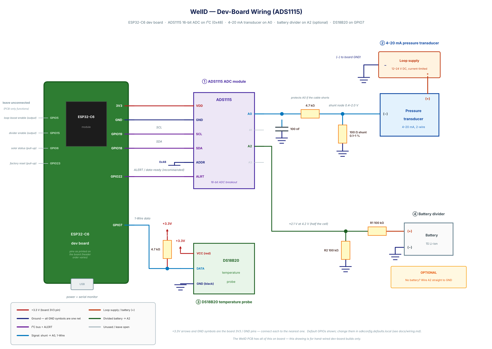

# WellD — Dev-Board Wiring Guide

This guide builds WellD from off-the-shelf parts: an ESP32-C6 development board, an **ADS1115** ADC breakout, a 4–20 mA pressure transducer and a DS18B20 temperature probe. Use it for bench testing or for a USB- or mains-powered install. No electronics experience is assumed — read the whole guide before touching any wires.

> **Have the WellD PCB?** Skip this guide. The board ([`hardware/pcb/`](../hardware/pcb/)) has all of these circuits on it, plus what a battery install needs: a 12 V loop supply that runs only during a reading, a switched battery divider, input protection and solar/USB charging.



*The diagram is generated by [`gen_wiring_diagram.py`](gen_wiring_diagram.py). To change it, edit the script and run `python3 docs/gen_wiring_diagram.py` (needs matplotlib) — don't edit the PNG.*

---

## How it fits together

The firmware takes every analog reading through an **ADS1115** 16-bit ADC on the I²C bus. It has no code for the ESP32-C6's built-in ADC, so the ADS1115 is required, not optional.

| What | Where it goes | Firmware turns it into |
|---|---|---|
| Transducer loop current | voltage across a 100 Ω shunt → ADS1115 **A0** | `water_level` (m) |
| Battery voltage (optional) | 2:1 resistor divider → ADS1115 **A2** | `battery_voltage`, `battery` (%) |
| DS18B20 probe | 1-Wire bus on **GPIO7** | `temperature` (°C), plus a water-density correction of the level |

---

## What you will need

| Item | Notes |
|---|---|
| ESP32-C6 development board | Any board with the ESP32-C6 chip, e.g. Espressif's ESP32-C6-DevKitC-1. The default wiring uses **GPIO7, GPIO18, GPIO19 and GPIO22** — check that your board brings them out to its pin headers, or see [Using other pins](#using-other-pins). |
| ADS1115 breakout module | The common 10-pin module (Adafruit or generic) with pins labelled **VDD, GND, SCL, SDA, ADDR, ALRT, A0, A1, A2, A3**. |
| 4–20 mA submersible pressure transducer | Two-wire (loop-powered) type whose range covers your well, e.g. 0–5 m. |
| Loop power supply, 12–24 V DC | At least 2 V above the transducer's minimum supply voltage (see [Supply voltage](#supply-voltage)). A bench supply with a current limit, or a plug-in adapter with a small fuse. |
| 100 Ω resistor, 0.1 % or 1 % | The shunt. Its tolerance goes straight into the level reading, so buy a precision part. ¼ W is plenty. |
| Two 4.7 kΩ resistors | One protects ADS1115 A0, one is the DS18B20 pull-up. |
| 100 nF ceramic capacitor | Noise filter on A0 (recommended). |
| DS18B20 waterproof temperature probe | Stainless probe on a three-wire cable. |
| Two 100 kΩ resistors, 1 % | Battery divider — only if you want to measure a battery. |
| Breadboard or terminal blocks, jumper wires | Terminal blocks are better for anything permanent. |
| Multimeter | For the checks before power-up. |

---

## Safety first

- **3.3 V only on the logic side.** The ESP32-C6 and the ADS1115 (powered from the board's 3V3 pin) must never see more than 3.3 V on any pin. The ADS1115 also cannot *measure* anything above its own 3.3 V supply.
- **The loop supply connects to the transducer (+) and to GND — nothing else.** In normal operation the most the ADC side ever sees is about 2.1 V across the shunt. If the transducer cable shorts, though, the *whole* loop voltage lands on the shunt: the 4.7 kΩ resistor in front of A0 keeps the current into the ADS1115 within its safe limit, and a current-limited (or ~50 mA fused) supply keeps the shunt from overheating.
- **One common ground.** The loop supply's (−) must be wired to the board's GND. Without it the loop current has no way back and the reading floats.
- Check every connection with a multimeter before plugging in USB.

---

## Pin summary

| Signal | ESP32-C6 pin | Connects to | Kconfig option (**WellD Sensor** menu) |
|---|---|---|---|
| Power | 3V3, GND | ADS1115 VDD, GND | — |
| I²C data | GPIO18 | ADS1115 SDA | `CONFIG_WELLD_I2C_SDA_GPIO` |
| I²C clock | GPIO19 | ADS1115 SCL | `CONFIG_WELLD_I2C_SCL_GPIO` |
| Conversion ready | GPIO22 | ADS1115 ALRT (recommended) | `CONFIG_WELLD_ADS1115_DRDY_GPIO` |
| I²C address 0x48 | — | ADS1115 ADDR → **GND** | fixed in the firmware |
| Transducer shunt | — | ADS1115 A0 (through 4.7 kΩ) | `CONFIG_WELLD_SENSOR_SHUNT_MILLIOHMS` |
| Battery divider | — | ADS1115 A2 — **tie to GND if you have no divider** | `CONFIG_WELLD_BATT_DIVIDER_RATIO` |
| Unused inputs | — | ADS1115 A1, A3 — leave open | — |
| Temperature probe | GPIO7 | DS18B20 DATA + 4.7 kΩ pull-up | `CONFIG_WELLD_DS18B20_GPIO` |

**Leave these pins unconnected.** The firmware uses them for circuits that exist only on the PCB:

| GPIO | What the firmware does with it | On a dev board |
|---|---|---|
| GPIO5 | Output: switches the PCB's 12 V loop supply on for each reading | Leave open — your loop supply simply stays on (but see [Battery-powered builds](#battery-powered-builds)) |
| GPIO15 | Output: switches the PCB's battery divider on for each reading | Leave open — a hand-wired divider is always connected |
| GPIO6 | Input with internal pull-up: solar-charger status | Leave open — reads as "not charging" (`solar_charging` = 0) |
| GPIO23 | Input with internal pull-up: factory reset | Leave open. Holding it to GND while the board boots erases NVS **and** the Zigbee network; the device then has to be paired again (*Permit join*) |

---

## Part 1 — ADS1115 ADC module

**Step 1 — Power.** VDD → **3V3**. GND → **GND**.

**Step 2 — I²C bus.** SDA → **GPIO18**. SCL → **GPIO19**. Keep these two wires short — under about 30 cm.

**Step 3 — Address.** ADDR → **GND**. This sets I²C address 0x48, the only address the firmware talks to.

**Step 4 — Conversion-ready signal.** ALRT → **GPIO22**. The ADS1115 pulls this line low the moment a measurement finishes, so the firmware does not have to keep asking. It is optional: without it each measurement waits out a 10 ms timeout and logs `ADS1115 DRDY edge not received within 10 ms — polling` — readings still work, just slower and noisier in the log. Connect it if you can.

```
  ESP32-C6                 ADS1115
  3V3    ───────────────── VDD
  GND    ──────────────┬── GND
                       └── ADDR      (I²C address 0x48)
  GPIO18 ───────────────── SDA
  GPIO19 ───────────────── SCL
  GPIO22 ───────────────── ALRT      (recommended)
```

> **Pull-up resistors.** SDA, SCL and ALRT are open-drain lines that need pull-ups to 3V3. Most ADS1115 breakouts already carry 10 kΩ pull-ups on SDA and SCL, and the firmware also switches on the ESP32-C6's internal pull-ups on SDA, SCL and GPIO22. That is enough for short wires. Add 4.7 kΩ from each line to 3V3 only if your module has none, or if the wires are long.

---

## Part 2 — Pressure transducer (water level)

### What this sensor does

The transducer hangs submerged in the well. Water pressure on its membrane sets the current it draws: **4 mA** at zero depth, rising to **20 mA** at the top of its range. The firmware measures that current and turns it into metres:

```
level = (current − 4 mA) ÷ 16 mA × CONFIG_WELLD_SENSOR_MAX_DEPTH_CM
```

### What the 100 Ω shunt does

The ADS1115 measures voltage, not current. Putting the 100 Ω resistor in the transducer's return path turns the current into a voltage (Ohm's law, V = I × R):

```
 4 mA × 100 Ω = 0.40 V   →  0 m (bottom of the range)
20 mA × 100 Ω = 2.00 V   →  top of the range (e.g. 6 m)
```

Below 3.5 mA (0.35 V) the firmware treats the transducer as disconnected, above 21 mA (2.10 V) as short-circuited. In both cases it publishes `water_level` as `null`, so Home Assistant shows the sensor as unavailable instead of a wrong number.

### Step-by-step wiring

Your transducer has two wires, usually red = **(+)** and black = **(−)** — check the cable label or datasheet.

**Step 1 — Loop power.** Loop supply **(+)** → transducer **(+)**.

**Step 2 — Shunt.** Transducer **(−)** → one leg of the **100 Ω** resistor. Its other leg → **GND**. The point where the transducer (−) wire meets the resistor is the *shunt node*.

**Step 3 — Common ground.** Loop supply **(−)** → **GND** — the same ground as the board and the ADS1115.

**Step 4 — Measurement.** Shunt node → **4.7 kΩ** resistor → ADS1115 **A0**. Then a **100 nF** capacitor from A0 to GND.

```
  Loop supply (+) ─────────────── Transducer (+)
                                  Transducer (−) ───┬─── 4.7 kΩ ───┬─── ADS1115 A0
                                    (shunt node)    │              │
                                                  100 Ω          100 nF
                                                  shunt        (recommended)
                                                    │              │
  Loop supply (−) ──────────────────────────────────┴──────────────┴─── GND
```

The 4.7 kΩ resistor barely affects the reading (about 0.1 % — less than a typical transducer's own error), but if the cable ever shorts it limits the current forced into A0 to a few milliamps, which the ADS1115 survives. The 100 nF capacitor filters noise picked up along a long transducer cable.

### Check before you trust it

Set the multimeter to DC volts and measure from the shunt node to GND with the loop supply on:

- **Transducer in air** (zero depth): about **0.40 V**.
- **Lowered into water:** the voltage rises steadily — 1.6 V spread over the transducer's range, so about 0.27 V per metre for a 0–6 m transducer.
- **About 0 V:** the loop is open. Check the supply, both transducer wires, the shunt and the loop supply (−) to GND link.
- **Above 2.1 V:** something is shorted or miswired. Switch off and check before connecting A0.

### Supply voltage

The transducer's datasheet gives its supply range, typically something like 9–36 V or 12–36 V. Your loop supply must cover the transducer's **minimum plus 2 V**, because the shunt takes up to 2 V at 20 mA. A 24 V supply suits nearly every transducer; a 12 V supply only suits transducers that work down to 10 V.

### A different shunt value

100 Ω suits almost every transducer. If you use another value, set `CONFIG_WELLD_SENSOR_SHUNT_MILLIOHMS` — in **milliohms**, so 100 Ω = `100000`. Stay at or below **130 Ω** (the option's upper limit): the firmware has to be able to see the 21 mA short-circuit threshold — 2.73 V at 130 Ω — below the ADS1115's 3.3 V supply.

---

## Part 3 — DS18B20 temperature probe

### What this sensor does

The DS18B20 is a digital thermometer sealed in a stainless steel probe. It talks over a single data wire (the "1-Wire" bus). Besides reporting the water temperature, the firmware uses it to correct the level reading for water density: warm water is lighter, so a given depth presses on the transducer a little less (`CONFIG_WELLD_TEMP_COMPENSATION_ENABLED`, on by default).

### Step-by-step wiring

| Wire colour (usual) | Name | Connects to |
|---|---|---|
| Red | VCC | **3V3** |
| Black | GND | **GND** |
| Yellow or white | DATA | **GPIO7**, *and* through the **4.7 kΩ** resistor to **3V3** |

The 4.7 kΩ pull-up is mandatory: the bus rests at 3.3 V and both ends talk by briefly pulling it low. Without the resistor nothing can be read. Always wire the red VCC wire to 3V3 — "parasite power" mode (VCC tied to GND) is not supported.

```
  3V3 ────┬──────────── Red (VCC)
          │
        4.7 kΩ           ← pull-up resistor
          │
  GPIO7 ──┴──────────── Yellow/white (DATA)

  GND ───────────────── Black (GND)
```

**Check:** with the board powered over USB, DATA should measure about 3.3 V to GND — the pull-up holding the idle line high.

### Placement

Lower the probe alongside the transducer so it measures the same water — the density correction depends on it. The stainless probe is rated for continuous submersion. Avoid sharp bends right at the probe head.

---

## Part 4 — Battery voltage (optional)

### No battery? Tie A2 to GND

If you are not measuring a battery, connect ADS1115 **A2 to GND** and set `CONFIG_WELLD_BATT_REPORT_ENABLED=n` (this removes the battery entities). **Do not leave A2 floating.** The firmware reads A2 on every wakeup for its low-battery guard, and a floating input can read any voltage — one that happens to look like a flat cell stops all reports. A grounded A2 reads 0 V, which the firmware recognises as "no divider" and ignores; it logs `battery reading 0.00 V is implausible — divider/AIN2 fault? ignoring it` once per wakeup.

### Why a divider

A full Li-ion cell is 4.2 V — more than the ADS1115 can measure on its 3.3 V supply. Two equal resistors halve it:

```
V(A2) = V(battery) × R2 ÷ (R1 + R2) = 4.2 V × 100 kΩ ÷ 200 kΩ = 2.1 V
```

### Wiring

- Battery **(+)** → **R1 (100 kΩ)** → junction → **R2 (100 kΩ)** → **GND**
- Junction → ADS1115 **A2**
- Battery **(−)** → **GND**

```
  Battery (+) ──── R1 100 kΩ ──┬──── ADS1115 A2
                               │
                          R2 100 kΩ
                               │
  Battery (−) ─────────────────┴──── GND
```

**Check:** A2 to GND should read half the battery voltage — about 2.1 V for a full cell — and must stay below 3.0 V.

This divider draws 4.2 V ÷ 200 kΩ = 21 µA all the time, about 0.5 mAh a day. (The PCB switches its divider off between readings with GPIO15; on a dev board the always-on loop supply costs far more anyway — see below.)

How you power the board from the cell is up to you — for example a board with a LiPo connector, or a low-dropout 3.3 V regulator such as the HT7333 the PCB uses. This section only measures the battery.

### Other packs

Choose R1/R2 so that A2 stays below about 3.0 V at full charge, then set:

```ini
CONFIG_WELLD_BATT_DIVIDER_RATIO=200   # (R1 + R2) ÷ R2 × 100 — 200 for two equal resistors
CONFIG_WELLD_BATT_FULL_MV=4200        # pack voltage at 100 %
CONFIG_WELLD_BATT_EMPTY_MV=3200       # sends and NVS writes stop at or below this
```

Set `CONFIG_WELLD_BATT_EMPTY_MV` to the pack voltage below which your regulator can no longer hold the ESP32-C6 at 3.0 V or more, and set the matching `battery_full_mv` / `battery_empty_mv` options for the device in Zigbee2MQTT so the percentage agrees. Readings below 2.0 V are always treated as a measurement fault, never as a flat battery.

---

## Battery-powered builds

With the loop supply always on, the transducer draws 4–20 mA around the clock. Boosted to 12 V from a single Li-ion cell, that is roughly 15–75 mA from the cell — an 18650 lasts days, not months. The PCB avoids this by switching its 12 V loop supply on only for each reading: the firmware drives **GPIO5 HIGH**, waits `CONFIG_WELLD_VLOOP_SETTLE_MS` (default 10 ms), takes the reading and drives GPIO5 LOW again straight away.

You can do the same on a dev board by switching your loop supply with GPIO5 (HIGH = on) — for example a boost module with an enable input, or a high-side MOSFET switch like the PCB's Q3/Q4 stage (see [`hardware/pcb/schematic_connections.md`](../hardware/pcb/schematic_connections.md)). Then make sure both the supply *and the transducer* have settled within the wait: some transducers need tens or hundreds of milliseconds after power-up before their output is valid. Check the datasheet's start-up (or "switch-on") time and raise `CONFIG_WELLD_VLOOP_SETTLE_MS` to match.

---

## Complete wiring checklist

Every connection in one place — tick them off as you go:

| Net | Everything on it |
|---|---|
| **3V3** | board 3V3 · ADS1115 VDD · DS18B20 red · top of the DS18B20 4.7 kΩ pull-up |
| **GND** | board GND · ADS1115 GND · ADS1115 ADDR · DS18B20 black · bottom of the 100 Ω shunt · 100 nF capacitor · loop supply (−) · R2 and battery (−) — *or A2, if you have no battery divider* |
| **SDA** | GPIO18 · ADS1115 SDA |
| **SCL** | GPIO19 · ADS1115 SCL |
| **ALERT** | GPIO22 · ADS1115 ALRT |
| **1-Wire** | GPIO7 · DS18B20 yellow/white · bottom of the 4.7 kΩ pull-up |
| **Loop +** | loop supply (+) · transducer (+) |
| **Shunt node** | transducer (−) · top of the 100 Ω shunt · one end of the 4.7 kΩ protection resistor |
| **A0** | other end of the 4.7 kΩ protection resistor · ADS1115 A0 · 100 nF capacitor |
| **Battery +** | battery (+) · R1 |
| **A2** | R1/R2 junction · ADS1115 A2 |

---

## Setting the firmware configuration

The pin defaults already match this guide (I²C on GPIO18/19, ALERT on GPIO22, DS18B20 on GPIO7), so most builds only describe the transducer. Create your local config file:

```bash
cp sdkconfig.defaults.local.example sdkconfig.defaults.local
```

and set, in `sdkconfig.defaults.local`:

```ini
# Pressure transducer
CONFIG_WELLD_SENSOR_SHUNT_MILLIOHMS=100000   # 100 Ω shunt
CONFIG_WELLD_SENSOR_MAX_DEPTH_CM=600         # depth at 20 mA = your transducer's range (600 = 6 m)

# Battery divider on A2 — these are the defaults, shown for reference
CONFIG_WELLD_BATT_DIVIDER_RATIO=200          # (R1 + R2) ÷ R2 × 100
CONFIG_WELLD_BATT_FULL_MV=4200
CONFIG_WELLD_BATT_EMPTY_MV=3200

# No battery divider (A2 tied to GND)? Drop the battery endpoint instead:
# CONFIG_WELLD_BATT_REPORT_ENABLED=n
```

Only add a `…_GPIO` line if you moved a wire. `sdkconfig.defaults.local` only seeds a **new** `sdkconfig`, so after creating or editing it, regenerate and build:

```bash
idf.py set-target esp32c6    # regenerates sdkconfig (the old one is kept as sdkconfig.old)
idf.py build
```

Alternatively, change the options interactively with `idf.py menuconfig` → **WellD Sensor**. Building, flashing and Zigbee pairing are covered in the [README](../README.md).

### Using other pins

If your board lacks one of the default pins, move that wire to any free GPIO and set the matching option from the [pin summary](#pin-summary). Avoid the boot-strapping pins (GPIO8, GPIO9, GPIO15), the native USB pins (GPIO12, GPIO13), the serial console (GPIO16, GPIO17) and the firmware's PCB pins (GPIO5, GPIO6, GPIO23). The DS18B20 option accepts GPIO0–21; the I²C and ALERT options GPIO0–23.

---

## Checking your work on first boot

Flash the firmware and open the serial monitor, e.g. `idf.py -p /dev/ttyUSB0 monitor` (the port name depends on your board and operating system). On boards with two USB ports, such as the DevKitC-1, prefer the **UART** port: the chip's native USB port disconnects every time it deep-sleeps.

**Everything working** (the number in brackets is milliseconds since boot):

```
I (305) sensor: ADS1115 DRDY interrupt configured on GPIO22
I (309) sensor: battery=4.05 V (divider)
I (326) sensor: voltage=1485 mV  current=14850 µA  level=4.07 m
I (341) sensor: DS18B20 ROM 0x5e0000005e3a7a28 stored to NVS
I (744) sensor: temperature=12.3 °C
I (745) sensor: temp-comp: raw=4.069 m temp=12.3°C factor=0.99841 compensated=4.062 m
```

The `DS18B20 ROM … stored to NVS` line appears only on the first boot, or after you swap the probe. Once the device has joined your Zigbee network, Zigbee2MQTT shows `water_level`, `temperature`, `battery_voltage` and `battery`; `water_level_rate` follows from the second reading on.

**When something is wrong:**

| Log line | What it means | What to check |
|---|---|---|
| `E … sensor: ADS1115 Hi_thresh write failed: …`, then `W … sensor: ADS1115 DRDY init failed — falling back to register polling` and `E … sensor: ADS1115 read failed on AIN0 (4-20 mA shunt)` (ESP-IDF's `i2c.master` driver adds its own "nack" errors) | The ADS1115 does not answer on I²C | VDD and GND; SDA on GPIO18 and SCL on GPIO19 (not swapped); ADDR to GND |
| `W … sensor: ADS1115 DRDY edge not received within 10 ms — polling` | ALRT is not connected — readings still work, just slower | ALRT → GPIO22 |
| `E … sensor: transducer open loop (voltage=0 mV, 0 µA < 3.5 mA)` | No loop current | Loop supply on; loop supply (−) to GND; both transducer wires; the shunt |
| `E … sensor: transducer short-circuit (voltage=3290 mV, 32900 µA > 21 mA)` | More than 21 mA | Shorted cable, or transducer (−) going to A0 without the shunt to GND |
| `E … sensor: no DS18B20 found on GPIO 7` | The probe does not answer | The 4.7 kΩ pull-up; DATA on GPIO7; red wire on 3V3, not GND |
| `W … main: battery reading 0.00 V is implausible — divider/AIN2 fault? ignoring it` | A2 reads below 2.0 V, so the reading is ignored | Expected when A2 is tied to GND (no divider). Otherwise check R1, R2 and the A2 wire |
| `W … main: battery critically low (3.15 V <= 3.20 V) — skipping send` | The low-battery guard skipped this report | Charge the cell. If you have no battery, A2 is probably floating — tie it to GND |

For anything else, see [`TROUBLESHOOTING.md`](../TROUBLESHOOTING.md).
